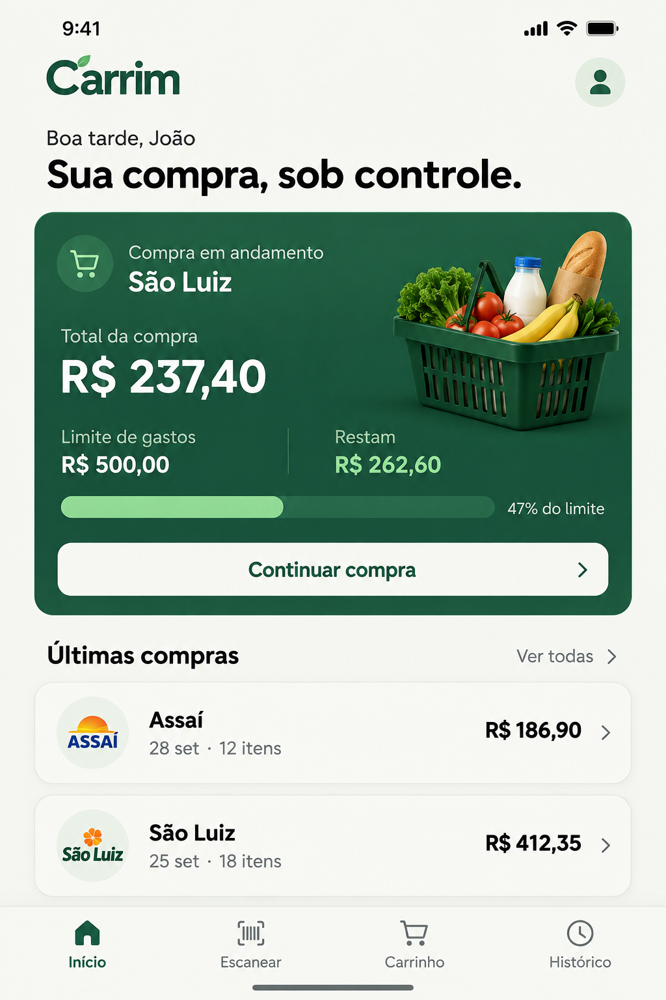
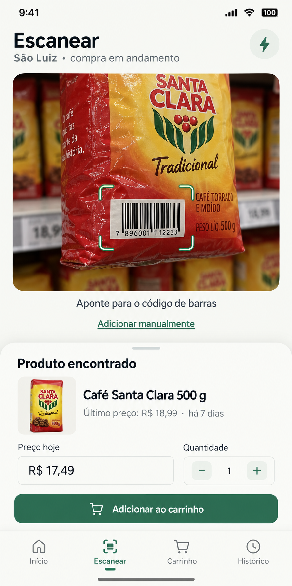
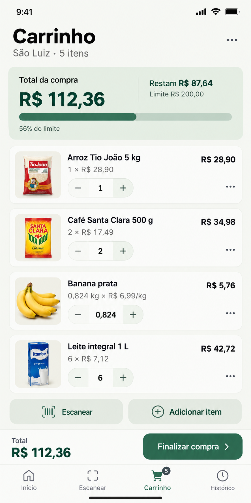
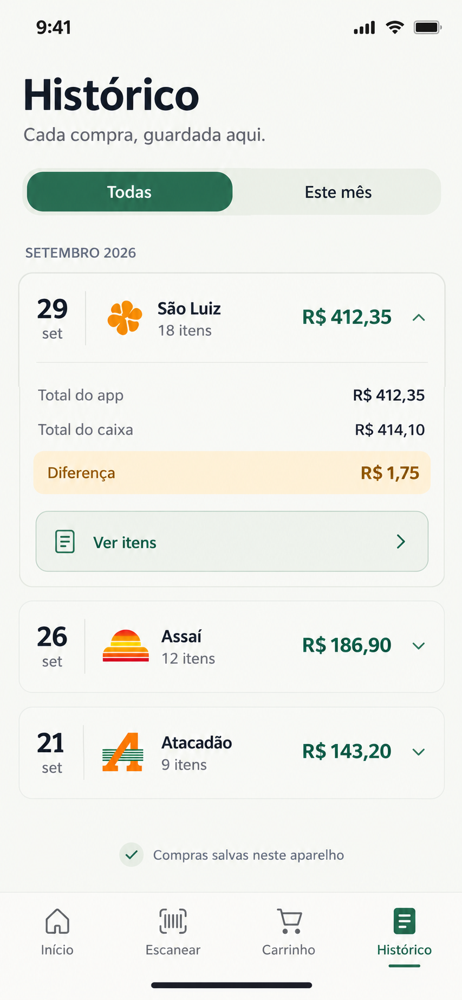

# Carrim — direção visual

Referência aprovada em 30/09/2026, consolidada em 16/10 e revisada localmente em 17/10/2026. Imagens e decisões vieram da pasta original do PC. São conceitos de interface, não screenshots de funcionalidades entregues. A revisão local foi autorizada antes da preparação do APK de teste.

## Identidade e hierarquia

Visual claro, sofisticado e confortável durante a compra. Cabeçalho aberto integrado ao fundo, sem faixa cinza separada; títulos próximos do topo respeitando safe areas. Verde profundo, fundo levemente quente, superfícies suaves, bordas discretas, cantos arredondados e sombras leves.

| Papel                   | Referência                                   |
| ----------------------- | -------------------------------------------- |
| Principal               | #246B50                                      |
| Fundo                   | #F7F8F4                                      |
| Texto                   | Escuro, próximo do preto; tema atual #17251F |
| Superfícies secundárias | Sálvia suave                                 |
| Atenção                 | Âmbar discreto acompanhado de texto          |

Verificar contraste, fonte ampliada, leitor de tela, foco e áreas de toque. Não depender só de cor, gestos ou animação. Total e ação principal devem ser fáceis de encontrar; teclado e rolagem não podem esconder finalização.

## Início

Priorizar compra ativa: mercado, total, limite/restante quando informado e Continuar compra. Compras recentes abaixo; sem compra ativa, ação clara para começar. Saudação/perfil dependem de identidade futura, sem exigir conta para comprar offline.

## Escanear

Área de câmera com controles discretos e alternativa manual. Ao detectar código, pausar leitura e confirmar preço/quantidade em sheet; evitar confirmações duplicadas. Preço anterior é referência com data, não preço atual preenchido automaticamente. Câmera negada deve orientar sem bloquear compra.

## Carrinho

Orçamento legível, subtotal por linha e total/finalização acessíveis. Unidade incrementa uma unidade; promoção incrementa grupo completo; peso usa edição apropriada, não copia o stepper ilustrado. Remoção tem confirmação e alternativa a gestos.

Contagem deve ter definição explícita: a lista atual conta linhas de produtos, não soma unidades com gramas. Não copiar contadores incoerentes dos exemplos. Valores persistidos em centavos e peso em gramas; interface em pt-BR.

## Histórico

Compras agrupadas por período, com mercado, data, linhas e total. Segmento Todas/Este mês e detalhes somente leitura. Total do caixa e diferença são opcionais; nulo não é zero e diferença não muda itens. Estado vazio deve explicar a próxima ação.

## Implementação e aceitação

Na consulta de código desconhecido, mostrar “Buscando produto…” com alternativa Cadastrar sem esperar. A ficha mantém tipografia, cores, outline e máscara atuais; a sugestão externa usa título “Confira o produto”, campos editáveis, conteúdo da embalagem sem alterar quantidade, preço vazio e foto opcional com placeholder em falha. Identificar Open Food Facts/ODbL e CC BY-SA 3.0 para foto, com links oficiais; não apresentar a sugestão como dado garantido. Nome/código confirmado são locais; fotos não são guardadas offline. Navegar, mudar compra ou escolher manual invalida resultados atrasados. Se o produto pessoal existe no servidor mas ainda não no SQLite, aguardar sincronização evita duplicar sua identidade.

- Prioridade: componentes/APIs Ionic e Angular, Tailwind tw:, CSS manual quando necessário. Customização Ionic por variáveis/parts públicos, sem seletores internos frágeis.
- Angular standalone, Signals para estado e templates HTML separados. Não forçar modo iOS no Android.
- Campos e seletores usam outline, borda de 1 px, raio de 12 px e foco verde. Apenas ion-input/ion-select usam modo Material para manter o outline também no iOS (fill é exclusivo de md no Ionic); o restante do app preserva o modo da plataforma. Quantidade agrupada e campos nativos dos alertas de limite/caixa seguem a mesma borda, com foco visível.
- Valores monetários têm máscara de reais com centavos automáticos e teclado numérico: 1999 vira R$ 19,99; 20000 vira R$ 200,00. Colagem de valor já formatado e valores de edição preservam o montante. Limpar mantém o opcional vazio, distinto de zero; domínio continua validando e persistindo centavos inteiros. Peso e quantidade não recebem máscara de moeda.
- Quatro abas fixas: Início, Escanear, Carrinho e Histórico, inclusive sem compra ativa.
- Usar componentes Ionic para tabs, cards, botões, inputs, progress, toast, alert e modal. Estados vazios/carregamento/erro concretos, sem negócio fictício.
- Miniaturas, logos e cesta nas imagens são ilustrações. Não pressupor catálogo de fotos, parceria ou autorização de marcas; usar placeholders até haver assets adequados.
- Atenção de sync deve dizer que compras foram preservadas e orientar revisão, sem expor token, SQL ou internals.
- Movimento: cápsula deslizante no filtro do Histórico, entrada suave ao trocar período/aba e adicionar itens, feedback de toque e progresso com transição. Indicador inferior ocupa toda a largura de uma aba e desliza entre as quatro posições. Durações curtas (140/260 ms), sem atrasar comandos ou persistência. A expansão do Histórico anima altura quando o navegador suporta, com entrada suave como alternativa; o controle continua sendo details nativo.
- Redução de movimento desativa as animações CSS acrescentadas; a configuração inicial do Ionic também respeita essa preferência. Haptics e validação física de movimento continuam pendentes.
- Revisar telas pequenas (320/390 px), safe areas, fonte ampliada, teclado, orientação, navegação assistiva e acesso à ação principal.

Os PNGs foram copiados sem edição, mantendo os quatro originais e nomes para rastreabilidade. A pasta pessoal permanece intacta. Revisões de layout entram neste guia; estado e prioridade ficam no [roadmap](https://github.com/JoaoVFAraujo/carrim-api/blob/main/docs/ROADMAP.md), sem novos documentos visuais por versão.

## Revisão local — 17/10/2026

As quatro abas foram conferidas no navegador local em larguras de 390 e 320 px. A direção permanece clara/sálvia, com cabeçalho integrado, total em destaque, cantos suaves e componentes Ionic; fotos/marcas ilustrativas não foram copiadas para a interface.

Ajustes: resumo do Carrinho com orçamento em colunas, totais longos com quebra e finalização acessível, nomes de itens com largura mínima antes de quebrar a linha, hierarquia/espaçamento do cartão ativo, cartões do Histórico com data e total, botão Fechar no formulário de produtos, superfícies de revisão de sync e foco visível. Botões principais mantêm área mínima de 44 px.

Fluxos conferidos: nova compra com/sem limite; edição/remoção de limite e cancelamento; produto por unidade, peso e grupo promocional; erro de grupo incompleto; cadastro por código e produto conhecido exigindo preço de hoje; finalização com caixa diferente; filtro/detalhes do Histórico e persistência após recarregar. A amostra de unidade/peso/promoção totalizou R$ 54,66, caixa R$ 55,00 e diferença +R$ 0,34. Valores máximos e nome longo foram conferidos em 320 px sem rolagem horizontal.

Esses ensaios validaram os fluxos locais, mas o usuário reprovou a fidelidade visual em 18/10: a tela só compartilhava o conceito com a referência. Não tratar a revisão de 17/10 como aprovação da composição. Câmera, teclado virtual, leitor de tela e Keystore/SQLite físicos também permanecem pendentes.

## Correção de composição — 18/10/2026

As referências guiam também proporções, densidade, posição das ações e desenho dos controles, não apenas a paleta. Não declarar fidelidade antes de comparar capturas na mesma largura e reconhecer diferenças concretas.

O Carrinho foi recomposto com resumo horizontal compacto (total à esquerda, restante/limite à direita), opções da compra no menu “⋯”, cartões em linhas com área de miniatura, quantidade agrupada, menu por item e ações de escanear/adicionar abaixo da lista. Peso continua com edição em kg, sem copiar o stepper ilustrativo. Contador do Carrinho representa linhas de produtos; mantém a definição documentada, não o número ilustrativo do conceito.

Comparação local em 390/320 px com quatro produtos, total R$ 112,36, limite R$ 200,00 e restante R$ 87,64. Menus preservam edição e confirmação de remoção/cancelamento; troca de compra enquanto o menu está aberto invalida a ação. Miniaturas usam placeholders porque o catálogo atual não contém fotos.

As outras três abas foram recompostas na sequência:

- Início: marca com folha, saudação sem identidade inventada, cesta ilustrativa própria, cartão verde com total/orçamento/progresso e compras recentes em linhas. O símbolo de perfil identifica o uso local; não simula uma conta ou ação disponível.
- Histórico: filtro em cápsula, data lateral, mercado/contagem/total, resumo expansível com app/caixa/diferença e botão Ver itens. Caixa nulo continua “Não informado”, inclusive distinto de zero; valores mantêm o sinal caixa − app. Itens antigos continuam somente leitura.
- Escanear: área de leitura grande com cantos marcados, alternativa manual e ficha inferior com nome/preço anterior datado, preço de hoje obrigatório e quantidade agrupada. O navegador explica a indisponibilidade da câmera, sem mostrar foto como se fosse uma leitura real. A câmera nativa mantém permissão por ação e encerramento ao sair; seu enquadramento real e teclado precisam de aparelho.
- Tipografia de sistema, ícones maiores nas abas e indicador da aba ativa. Capturas locais em 390/320 px, abertura/fechamento dos itens do Histórico, filtro, edição de quantidade e navegação conferidos. Não houve rolagem horizontal das páginas na amostra; preço e nome continuam editáveis na ficha.

Os estados sem compra do Início e do scanner também usam o verde profundo dos cards de destaque, texto claro e botão claro. No Início, a cesta fica à direita da mensagem, evitando o card sálvia com imagem central que destoava da referência. Os cabeçalhos principais são alinhados à esquerda tanto em Material quanto no modo visual iOS; isso não força o modo iOS no Android.
Os estados vazios de Histórico e Carrinho compartilham agora esse mesmo card verde, com ação clara e contraste de texto. A mudança de período não mantém duas listas simultâneas ou altera compras; apenas anima a entrada da lista filtrada.
O resumo de orçamento do Carrinho também usa o verde profundo, com total claro, restante em verde claro e alerta de excesso em tom claro legível. As ações Escanear e Adicionar item usam verde principal com texto branco, mantendo a leitura dos estados desabilitados.

A conferência visual do usuário, fotos reais do catálogo, leitor de tela, fonte ampliada e aparelho continuam pendentes. Não declarar equivalência exata às imagens nem avançar para distribuição apenas pelos testes funcionais.

Origem da cesta ilustrativa

Asset local: [public/images/grocery-basket.png](../public/images/grocery-basket.png), gerado com a ferramenta integrada de imagens, com transparência e sem marcas. É decoração do Início, não foto de um produto do catálogo. Prompt usado:

> Use case: product-mockup. Asset type: small transparent hero illustration for Carrim grocery shopping mobile app. Create a single rich dark forest green plastic supermarket shopping basket filled with fresh lettuce, tomatoes, a few bananas, a baguette in kraft paper and a plain glass milk bottle with blue cap. No brands, no labels, no words. Realistic premium studio product render, three-quarter view, basket handle partly upright, compact tall composition, soft light upper left, natural textures, crisp silhouette, subtle grounded shadow. Entire basket and groceries fully inside image, centered filling canvas with minimal transparent padding. Background genuinely transparent. Intended to be displayed at 150px wide on a deep green card. No backdrop, no table, no border, no text, no watermark.

## Fotos persistentes e aprovação — 21/10/2026

Miniaturas usam área limitada e imagem posicionada dentro do contêiner com object-fit:contain, preservando proporção de garrafas altas, imagens largas e quadradas. Foto e formulário não podem se sobrepor. O componente é compartilhado entre ficha e Carrinho; falha/ausência usa placeholder. Na ficha, controles da foto ficam sob a identificação, sem duplicar a prévia.

Adicionar/Trocar foto abre câmera/galeria no nativo ou seleção JPEG/PNG no navegador. Mostrar prévia e permitir remover/restaurar explicitamente o catálogo antes de salvar. A foto removida não reaparece por fallback externo; a escolha pessoal tem preferência. Foto não enviada indica envio pendente; após confirmação do servidor indica aguardando aprovação. Foto rejeitada continua visível ao autor, com opção de substituir, e não é publicada.

A contribuição é pública somente após aprovação administrativa; a interface explica essa condição antes de confirmar. O painel /admin/fotos é separado das quatro abas de compra e protegido por chave de operador. Permite filtrar pendentes/aprovadas/rejeitadas, ampliar a prévia para conferência, aprovar, rejeitar e retirar publicação. A chave é ocultada na entrada e não vai para URLs ou armazenamento do navegador. Créditos/licenças de imagens externas continuam visíveis; adaptação de tamanho/formato é indicada quando houver importação.

Revisão inclui fotos altas/largas/quadradas, fonte ampliada, teclado, nomes longos, ausência de imagem, permissões/cancelamento e retorno da captura após encerramento do processo. Capturas e aprovação do usuário no aparelho são verificações separadas da revisão de código.

## Continuidade do fluxo de compra

Depois de salvar uma nova compra, fechar o modal Ionic antes de abrir o Carrinho. Ao alterar quantidades ou receber atualizações de sincronização, manter o conteúdo atual montado; o carregamento completo aparece apenas antes da primeira leitura bem-sucedida. Falhas de leitura continuam visíveis e permitem nova tentativa.

Em Histórico > Ver itens, exibir miniaturas contidas de 80 × 88 px ao lado do nome e dos valores. Usar código de barras ou ID do item manual e o mesmo componente do Carrinho; ausência/remoção de foto mantém placeholder. A legenda informa que são fotos atuais dos produtos, sem congelar versões da imagem nem alterar nomes, quantidades ou preços registrados na compra finalizada.
